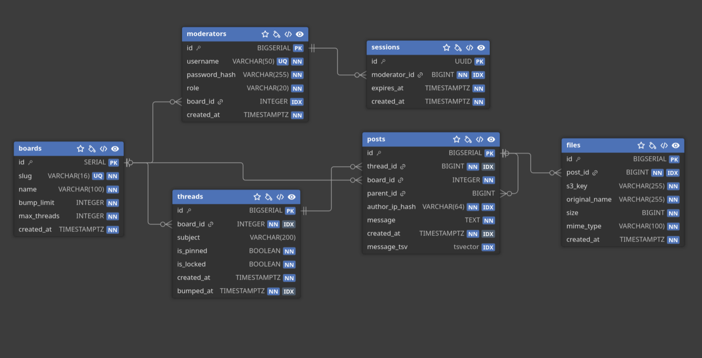

# Project documentation

This directory contains the PostgreSQL schema and its entity-relationship diagram for the imageboard backend.

- [`db.sql`](./db.sql) defines the tables, relationships, defaults, and indexes. Apply it to an empty database during setup; Docker Compose starts PostgreSQL but does not load this schema automatically. See the [backend setup guide](../backend/README.md).
- [`er.png`](./er.png) shows the database entities and their relationships.

## Entity-relationship diagram

## Schema overview

The content model is `boards` → `threads` → `posts`. Each post belongs to a board and thread, and a composite foreign key keeps those board references consistent. Posts may reference a parent post, have a generated full-text search vector, and can have associated file records. Moderators may be associated with a board; UUID sessions belong to moderators.

Each board can have one banner stored in MinIO with metadata in `board_banners`, plus an ordered list of entries in `board_rules`. `reports` can target a thread or post. `bans` support board-scoped or global IP-hash bans with optional expiration. `moderation_actions` records moderator actions with JSONB details and keeps target IDs as audit values so history can outlive deleted content.

Deleting a board cascades to its threads, posts, files, and board-scoped moderators. Deleting a thread cascades to its posts and files. Deleting a post sets `parent_id` to `NULL` on replies that referenced it.

Indexes support thread ordering by board, post lookup by thread and IP hash, full-text search over messages, file lookup by post, session expiration, report queues, ban checks, and moderation history. `message_tsv` is generated from each post's message using PostgreSQL's `simple` text configuration.

`db.sql` is a bootstrap schema for a new, empty database, not a migration for an existing database. The new moderation, banner, and board-rule tables are schema support; their API endpoints and application workflows still need to be implemented.
